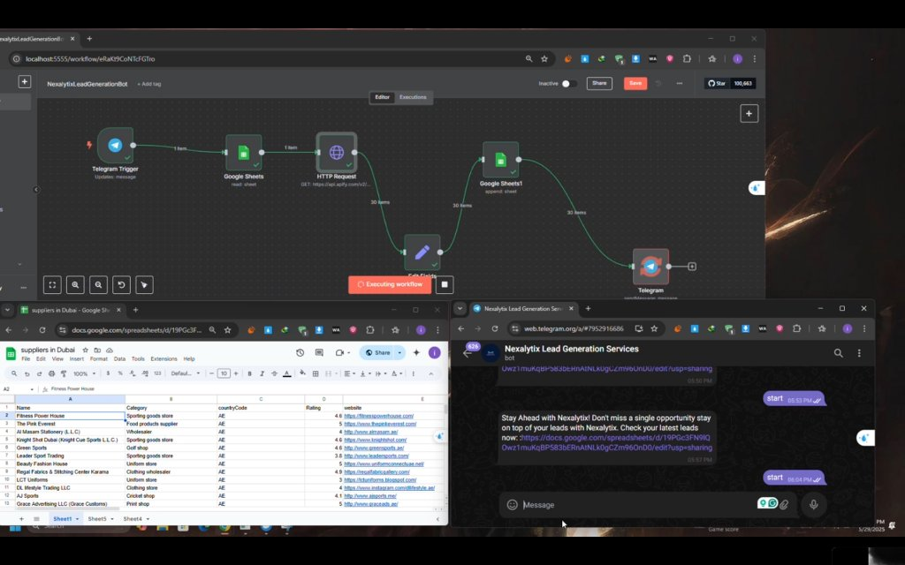
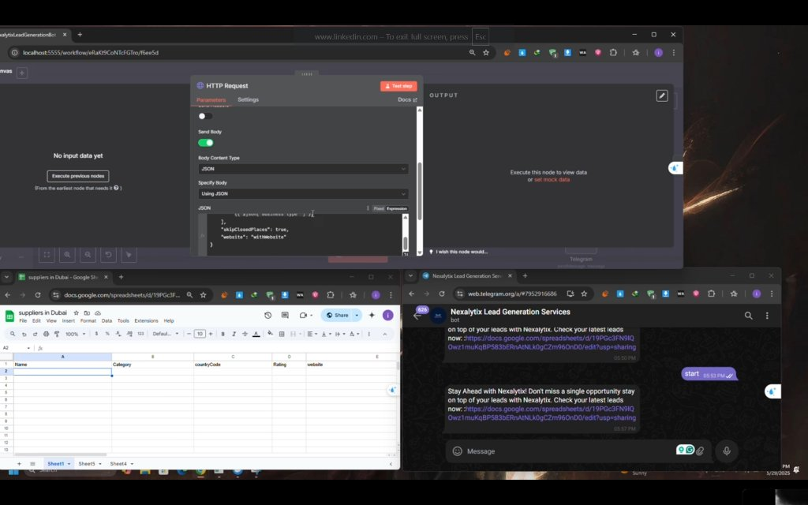

# Automated B2B Lead Generation & Supplier Discovery Pipeline (n8n + Apify)

An end-to-end, low-code automation workflow built with **n8n**, **Apify API**, **Google Sheets**, and **Telegram** to automate B2B supplier discovery and lead generation from Google Maps.

---

## 🎯 The Challenge

- **Client:** An Egyptian garment factory exporting abroad in large quantities.
- **Problem:** The client needed to quickly identify and reach reliable textile suppliers in Dubai. Manual searching on Google Maps was:
  - Extremely time-consuming
  - Prone to human error
  - Non-repeatable and difficult to scale across new domains or regions

---

## ⚙️ The Automated Solution

I designed and implemented an end-to-end **n8n** automation workflow that turns a simple Telegram command into a structured, ready-to-use supplier database:

1. **Telegram Trigger (`Nexalytix Lead Generation Services`):** The client sends a simple command (e.g., `start`) on Telegram to kick off the pipeline.
2. **Google Sheets Input:** Reads the target search query and domain parameters (e.g., `textile suppliers Dubai`) from a configured Google Sheet.
3. **HTTP Request via Apify API:** Queries the Apify Google Maps Scraper API (`skipClosedPlaces: true`, `website: "withWebsite"`) to extract rich business data (`Name`, `Category`, `Country Code`, `Rating`, `Phone`, `Website`, etc.).
4. **Data Cleaning & Structuring (`Edit Fields`):** Transforms the raw JSON response from Apify into clean, normalized, and structured records.
5. **Google Sheets Append:** Appends the verified, structured leads directly into the target Google Sheet in real time.
6. **Telegram Notification:** Sends an instant confirmation message to the client on Telegram with a direct link to the updated Google Sheet.

---

## 📸 Workflow & Configuration Screenshots

### 1. End-to-End n8n Workflow, Google Sheets Output & Telegram Bot

### 2. Apify HTTP Request Node Configuration

---

## 📊 The Results

- **1,000+ Verified Leads** collected in **less than 2 hours**
- **Zero Manual Effort** required after initial trigger
- **Structured, Analysis-Ready Data** in Google Sheets
- **Reusable Workflow** adaptable to any industry, keyword, or geographic domain

---

## 🛠️ Tech Stack

- **Orchestration:** n8n (Self-Hosted)
- **Data Extraction:** Apify Google Maps Scraper API
- **Storage & Input:** Google Sheets API
- **Interface & Notifications:** Telegram Bot API
- **Data Format:** JSON
